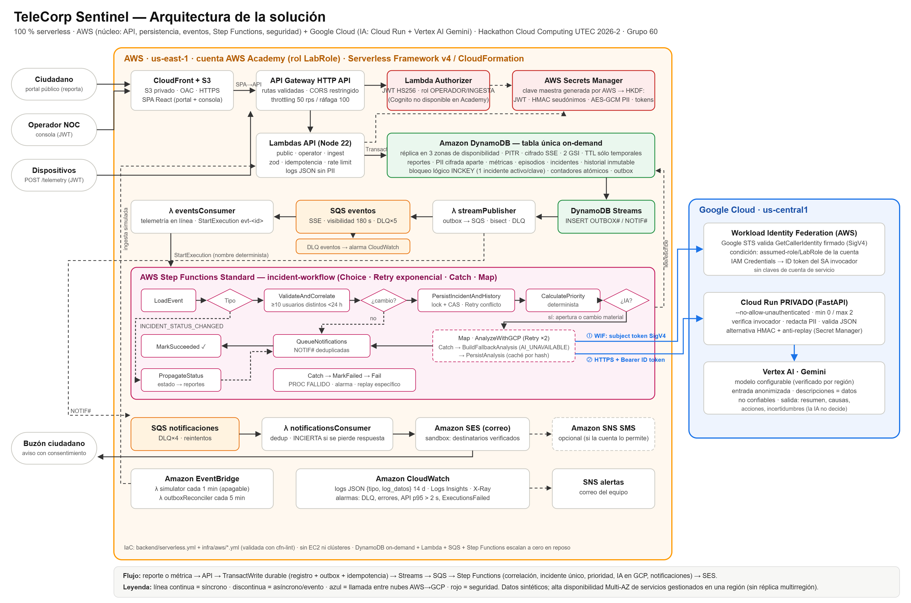

# TeleCorp Sentinel

Monitoreo de antenas móviles, reportes ciudadanos e incidentes priorizados con IA.
**Hackathon Cloud Computing UTEC 2026-2 · Grupo 60** · 100 % serverless: **AWS** (núcleo) + **Google Cloud** (IA).

> Proyecto académico con **datos sintéticos**: zonas, antenas, coordenadas y coberturas son ficticias. No representa a ningún operador real.



## Qué resuelve

| Problema | Solución |
|---|---|
| Antenas que fallan sin que nadie lo note | Telemetría cada minuto clasificada **exactamente**: `0` INHABILITADA · `0<x<60` CAÍDA · `60≤x≤129` NORMAL · `>129` SATURADA. Se rechazan negativos y no finitos; **SIN_DATOS** es distinto de 0. Se abre **un** incidente por antena desde la primera lectura anómala (no uno por minuto) |
| Reclamos dispersos | Portal público: ticket opaco y token de consulta (solo se guarda su hash), con los datos personales cifrados (AES-GCM) |
| Incidentes masivos | **≥10 personas distintas** (HMAC de la identidad) en una ventana **estrictamente menor de 24 h**, por zona y familia de problema ⇒ posible incidente colectivo, aunque las antenas estén normales ("investigación pendiente") |
| Priorizar | Puntaje determinista y explicable (reportantes, usuarios estimados sin duplicar coberturas, criticidad de zona, gravedad de antena, duración) ⇒ CRÍTICA, ALTA, MEDIA o BAJA |
| Cerrar el ciclo con el usuario | Notificaciones deduplicadas (SES) al evaluar el reporte, al confirmar una incidencia en la zona y al restablecerse el servicio verificado |
| Fallas que se repiten | Recurrencia: 3 episodios en 7 días ⇒ revisión estructural |
| Apoyo al operador | Gemini (Vertex AI, en GCP) resume, propone causas e indica incertidumbres. **No decide** nada. Si no está disponible, hay un respaldo etiquetado `AI_UNAVAILABLE` |

## Arquitectura

- **AWS** (`us-east-1`, compatible con AWS Academy / LabRole):
  - API Gateway HTTP API (CORS restringido, throttling) y Lambda (Node.js 22, TypeScript).
  - Lambda Authorizer con JWT (Cognito no está disponible en AWS Academy).
  - DynamoDB on-demand con tabla única: Multi-AZ, PITR, cifrado, Streams.
  - Patrón outbox: Streams → SQS (con DLQ) → **Step Functions Standard**.
  - SQS de notificaciones → SES.
  - EventBridge (simulador cada minuto y reconciliador del outbox).
  - **Secrets Manager**; CloudWatch (logs JSON, alarmas, X-Ray); S3 privado + CloudFront (OAC).
- **Google Cloud** (`us-central1`): Cloud Run **privado** (FastAPI, min 0) + **Vertex AI Gemini**. AWS lo invoca **sin claves** mediante **Workload Identity Federation** (el ID token lleva como audiencia la URL de Cloud Run). Existe una alternativa HMAC con protección anti-replay.

Detalle: [`docs/architecture.svg`](docs/architecture.svg) · fuente Mermaid [`docs/architecture.mmd`](docs/architecture.mmd) · modelo de datos [`docs/data-model.md`](docs/data-model.md) · contrato [`contracts/openapi.yaml`](contracts/openapi.yaml).

### Flujo confiable

1. `POST /reports` o `/telemetry`: validación con zod y **una sola TransactWrite** (registro + idempotencia + outbox). Responde 201 solo después de que la escritura es durable.
2. DynamoDB Streams → `streamPublisher` → SQS (con reintentos, DLQ y *batch item failures*). Un reconciliador re-publica el outbox pendiente.
3. `eventsConsumer`: la telemetría se aplica en línea (CAS por versión; los eventos fuera de orden no hacen retroceder el estado). Los reportes, episodios y cambios de estado inician Step Functions con un **nombre determinista** `evt-<eventId>`.
4. Workflow: `LoadEvent → RouteByType → ValidateAndCorrelate → HasChanges → PersistIncidentAndHistory → CalculatePriority → AIRequired → Map(AnalyzeWithGCP | Fallback) → QueueNotifications → MarkSucceeded`. Usa Retry exponencial con jitter y Catch → `MarkFailed` (persistido, con alarma y replay específico).
5. Notificaciones: ítems `NOTIF#` deduplicados → SQS → SES. Si se pierde la respuesta del proveedor, se marcan **INCIERTA** (sin reenvío automático). Nunca se afirma "recibido", solo "aceptada por el proveedor".

## Inicio rápido (local, sin nube)

Requisitos: Node.js ≥ 22. Python 3.12+ solo para el servicio de IA.

```bash
npm install
```

```bash
npm run seed -- --reset
```

```bash
npm run dev:api
```

En otra terminal:

```bash
npm run dev:web
```

- Portal: http://localhost:5173
- Consola: `/operador/login`, usuario `operador.demo`. La contraseña está en `.local/operator-credentials.txt`, que la semilla genera y git ignora.
- El modo local usa **emuladores etiquetados**: la tabla en memoria se persiste en `.local/db.json`; también se emulan las colas, la máquina de estados (la **misma** definición ASL de AWS ejecutada por un intérprete local) y el buzón (`.local/mailbox`). **No equivale a la nube.**
- Sin `AI_SERVICE_URL`, la IA cae al respaldo etiquetado `AI_UNAVAILABLE`.

### Comandos

| Comando | Qué hace |
|---|---|
| `npm test` | 44 pruebas del backend (dominio, flujo completo, carreras, IA y WIF, límite de tasa) |
| `npm run demo -w backend` | Demo de aceptación: 12 escenarios medidos (9+1 usuarios, 10 simultáneos, límites, recuperación, recurrencia…) |
| `npm run typecheck` · `npm run lint` · `npm run build` | Calidad y build (bundle Lambda ESM y SPA) |
| `cd ai-service && python -m venv .venv && .venv/Scripts/pip install -r requirements-dev.txt && .venv/Scripts/python -m pytest` | 7 pruebas del servicio de IA |
| `python scripts/validate_iac.py` | Ensambla la plantilla CloudFormation y la valida con cfn-lint, **sin desplegar** |
| `bash scripts/check-no-secrets.sh` | Escaneo de credenciales, JWT, claves privadas y material privado antes de commit/push (también en CI) |
| `API_URL=… npx tsx scripts/smoke-test.ts` | Smoke test contra la API local o desplegada |
| `API_URL=… OPERATOR_USER=… OPERATOR_PASSWORD=… LOAD_TOTAL=1000 npx tsx scripts/load-test.ts` | Ráfaga controlada: mide aceptados, p95 y convergencia, y guarda el resultado en `docs/evidence/` |

Resultado medido en **local emulado**: 1000 reportes concurrentes; 1000 aceptados, 1000 procesados, 0 fallidos; p95 de ingesta 211 ms; convergencia en 2.4 s (`docs/evidence/`). **No es una medición en la nube.**

## Despliegue real (manual, con tu autorización)

> Los scripts **verifican la identidad** (sin mostrar credenciales), **piden confirmación** antes de crear recursos con coste y son re-ejecutables.

### 0. Comprobar la cuenta (solo lectura, sin coste)

```bash
bash scripts/check-aws-services.sh
```

```bash
GCP_PROJECT_ID=<proyecto> bash infra/gcp/check-gcp.sh
```

### 1. Google Cloud (IA)

1. `gcloud auth login` y `gcloud auth application-default login`. El proyecto necesita facturación o créditos.
2. Elige un modelo Gemini disponible en tu región (Vertex AI → Model Garden) y verifícalo:
   ```bash
   GOOGLE_CLOUD_PROJECT=<proyecto> VERTEX_LOCATION=us-central1 GEMINI_MODEL=<modelo> python ai-service/scripts/check_model.py
   ```
3. Despliega (crea Cloud Run privado, cuentas de servicio y el pool WIF limitado a `assumed-role/LabRole` de tu cuenta):
   ```bash
   GCP_PROJECT_ID=<proyecto> AWS_ACCOUNT_ID=<12 dígitos> GEMINI_MODEL=<modelo> bash infra/gcp/deploy-gcp.sh
   ```
   El script imprime `aiServiceUrl`, `gcpProjectNumber` y `gcpInvokerSa`, que no son secretos.

### 2. AWS (AWS Academy Learner Lab)

1. Inicia el Learner Lab y copia "AWS Details" a `~/.aws/credentials` (duran 4 h). Ejecuta `npx serverless login` (Serverless Framework v4, como en el curso).
2. SES (opcional): verifica el remitente y los destinatarios de prueba en la consola de SES. En sandbox solo se entrega a identidades verificadas.
3. Despliega:
   ```bash
   SES_FROM_EMAIL=<verificado> NOTIFY_ALLOWED_RECIPIENTS=<verificados> AI_SERVICE_URL=<url> GCP_PROJECT_NUMBER=<n> GCP_INVOKER_SA=<sa> bash scripts/deploy-aws.sh
   ```
4. Crea el operador. La contraseña se lee de la variable y no se imprime:
   ```bash
   OPERATOR_PASSWORD='<elige>' TABLE_NAME=telecorp-sentinel-dev AWS_REGION=us-east-1 npx tsx scripts/create-operator.ts operador.demo
   ```
5. `API_URL=<HttpApiUrl> npx tsx scripts/smoke-test.ts`. Activa el simulador solo para la demo con `SIMULATOR_ENABLED=true bash scripts/deploy-aws.sh`.

Si `check-aws-services.sh` indica que falta un servicio:

| Falta | Ajuste |
|---|---|
| CloudFront | `--param=deployFrontend=false` y sirve el frontend en local con `VITE_API_BASE_URL=<HttpApiUrl>` |
| X-Ray | `tracing=false` |
| Scheduler | `scheduleKind=rule` (valor por defecto) |
| SES | Las notificaciones quedan registradas como `OMITIDA` |
| WIF | `infra/gcp/enable-hmac-fallback.sh` + `aiAuthMode=hmac` (alternativa explícita, con anti-replay) |

### Limpieza

```bash
bash scripts/cleanup-aws.sh
```

```bash
GCP_PROJECT_ID=<proyecto> bash infra/gcp/cleanup-gcp.sh
```

La tabla DynamoDB se **conserva** (`Retain`); el script indica cómo borrarla.

## Costes (estimación con supuestos; **no es cero**)

Supuestos: demo de unas 3 h con el simulador encendido (14 antenas/min), unos 2000 reportes y 100 análisis de IA. Precios de lista de us-east-1 y us-central1 a la fecha; verifícalos en las calculadoras oficiales.

| Servicio | Fuente de coste | Orden de magnitud |
|---|---|---|
| Step Functions Standard | Unos 12 a 15 estados por reporte × 0,025 USD / 1000 transiciones | ~0,75 USD por 2000 reportes |
| Lambda / API Gateway / SQS | Por invocación y solicitud (gran parte en la capa gratuita) | < 1 USD |
| DynamoDB on-demand + PITR | Por escritura, lectura y GB | < 1 USD |
| Secrets Manager | 0,40 USD/secreto/mes (prorrateado) + llamadas (con caché de 5 min) | ~0,40 USD/mes |
| CloudWatch | 7 alarmas × 0,10 USD/mes + logs (retención 14 días) | ~1 USD/mes |
| CloudFront / S3 / SES | Capa gratuita / 0,10 USD por 1000 correos | ~0 a 0,1 USD |
| Cloud Run | min 0 ⇒ sin coste en reposo; por vCPU-segundo cuando atiende | ~0 USD |
| Vertex AI Gemini | Por tokens: unos 1000 tokens por análisis, con caché por hash y solo ante cambios materiales | Céntimos a unos pocos USD |

Controles: el simulador está **apagado por defecto**; `maximumConcurrency` de SQS es 5 y 2; Cloud Run tiene `max-instances=2`; los logs se retienen 14 días; la IA solo se invoca ante cambios materiales y con caché. Configura un presupuesto o alerta en GCP (Billing → Budgets). **Los presupuestos alertan, no son topes.**

## Seguridad y privacidad

- **Secretos:** una clave maestra **generada por AWS Secrets Manager**, de la que se derivan con HKDF las claves de JWT, HMAC de seudónimos, AES-GCM de PII, tokens de ticket y HMAC de IA. Nada sensible en git, en el frontend ni en `.env`.
- **PII:** se cifra aparte, no se registra en logs y se enmascara en la consola. A la IA solo llegan datos agregados y descripciones redactadas. El conteo de personas usa HMAC de la identidad normalizada, no un hash simple del DNI.
- **API:** Lambda Authorizer en `/operator/*` y `/telemetry`; CORS solo para el dominio de CloudFront; throttling; límite por IP con contador atómico; el token de consulta viaja en el cuerpo, nunca en la URL.
- **Integridad:** idempotencia en todas las entradas; historial de solo inserción; reapertura explícita y auditada; transiciones de estado validadas.

## Limitaciones conocidas (honestas)

- La evidencia de nube (Step Functions, Cloud Run y Gemini en ejecución, correos SES) **queda pendiente hasta el despliegue autorizado**. Lo demás está verificado en local con emuladores etiquetados.
- La alta disponibilidad es Multi-AZ dentro de **una** región. No hay réplica multirregión ni multinube de los datos.
- La caché de nonces del modo HMAC es por instancia (por eso ese modo usa `max-instances=1`).
- No se pudieron abrir algunos materiales de Canvas (ver [`docs/course-coverage.md`](docs/course-coverage.md)).

## Estructura

```text
backend/        dominio, repositorios, servicios, handlers Lambda, runtime local, statemachine ASL, serverless.yml
frontend/       React + Vite + TypeScript (portal + consola)
ai-service/     FastAPI + Vertex AI (Cloud Run), pruebas pytest
infra/aws/      recursos CloudFormation incluidos por Serverless, rol IAM opcional
infra/gcp/      despliegue, verificación y limpieza en GCP (WIF, Cloud Run)
contracts/      OpenAPI 3.1
scripts/        despliegue, limpieza, smoke test, carga, validación IaC, verificación de servicios
docs/           arquitectura (entregable) y notas internas
```
